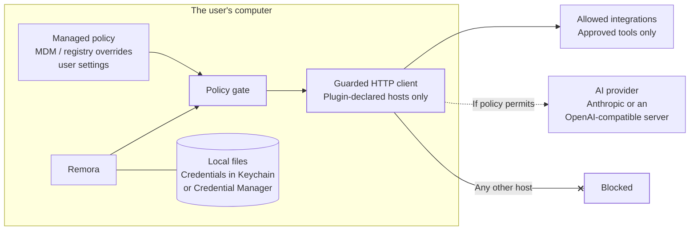

# For IT and compliance

Remora is a menu bar app on macOS, and a tray app on Windows (in preview), that reads your people’s work tools (GitHub,
GitLab, Slack, Linear, Jira, Notion, Microsoft 365) and shows what needs them. It is built for organizations with strict data rules: **no
data leaves the computer except to the tools the user, or the organization, allows.**

## In short

| Question                                       | Answer                                                                                                                                                                                   |
| ---------------------------------------------- | ---------------------------------------------------------------------------------------------------------------------------------------------------------------------------------------- |
| Is there a Remora server or cloud?             | No. The app talks directly to the tools; nothing goes through a third party.                                                                                                             |
| Accounts, telemetry, analytics, crash reports? | None.                                                                                                                                                                                    |
| What does it send to the tools?                | Each user’s own token and read requests. It never writes to the tools.                                                                                                                   |
| Where is data stored?                          | On the computer only: a few JSON files in the user’s own folder, tokens in the login Keychain (macOS) or the Credential Manager (Windows).                                               |
| AI?                                            | On-device only by default (Apple’s NaturalLanguage framework on macOS, keyword rules on Windows). The assistant (Claude or an OpenAI-compatible server) is opt-in, and can be forbidden. |
| Can IT lock it down?                           | Yes: allowed tools, external AI, the assistant’s servers and avatars, through a configuration profile (macOS) or Group Policy and Intune (Windows).                                      |
| Accessibility?                                 | Aims at WCAG 2.1 AA, partially conformant today: VoiceOver, Narrator and the keyboard, with the known gaps listed in the [accessibility statement](./accessibility).                     |
| Source code?                                   | Public, GPL-3.0-or-later: [github.com/iGitScor/triage](https://github.com/iGitScor/triage).                                                                                              |

## How it is enforced

1. **Declared destinations.** Every plugin declares, in its manifest, the hosts it may reach and what it sends. A
   test fails if a plugin doesn’t.
2. **Policy gate.** The app builds plugins in one place. It refuses a plugin the policy doesn’t allow, and gives the
   others an HTTP client limited to their own hosts (plus the account’s host for self-hosted tools). Any other host
   fails with “Blocked: … is not an allowed destination”, look-alike domains included, and that is tested too.
3. **External AI off by default.** An assistant that sends content off the computer is refused until external AI is
   allowed; a server on this computer follows `AllowLocalAI`.
4. **Visible to the user.** Settings → Privacy lists each connected account’s destinations, and erases all local
   data in one click.

## Next

- [Security overview](./security): the answers to a vendor security questionnaire, on one page.
- [Data flows](./data-flows): every flow, what is sent, and what stays on the computer.
- [Managing the policy with MDM](./mdm): the keys, a ready-to-use configuration profile, and the Windows registry values.
- [Deploying Remora](./deployment): the DMG and the Windows installer, signing, and updates.
