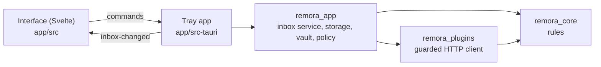

# Remora for Windows and Linux

Status: **preview**, for colleagues on Windows, and on Linux (community supported). A [Tauri 2](https://tauri.app)
tray app: a Rust core and a Svelte interface on WebView2 (WebKitGTK on Linux). It ports the macOS rules and plugins
with the same fixtures and tests, so the apps behave the same.

## Packages

Each release attaches:

| System | File | Install | Updates |
|---|---|---|---|
| Windows | `Remora-Setup.exe` | For you only, no admin rights needed | Itself, when you opt in |
| Windows | `Remora.msi` | For every user, by IT (see [Deployment](/admin/deployment)) | IT deploys each version |
| Linux | `Remora-x86_64.AppImage` | Anywhere, no install | Itself, when you opt in |
| Linux | `Remora-amd64.deb` | Debian, Ubuntu and derivatives | Install the next one |

## Next to the Mac

The same on every system: every source (GitHub, GitLab, Bitbucket, Azure DevOps, Slack, Linear, Jira, Notion,
Microsoft 365), the assistant, snooze reasons and insights, review prep, the waiting assistant, personal ranking,
Slack reactions, offline mode, updates and the privacy policy. What differs:

| | macOS | Windows | Linux |
|---|---|---|---|
| Sorting messages by meaning | Keywords, then an on-device language model | Keywords only: without one, a message goes to *To reply* | As Windows |
| Links between tools | Ticket keys, words and on-device embeddings | Ticket keys and words: fewer links | As Windows |
| Opening Remora | Click the menu bar fish | Click the tray icon | *Open Remora* in the tray menu; a window at launch where the desktop has no tray (stock GNOME) |
| New reminder | Drag the fish down | Ctrl+Alt+R (tray icons can’t be dragged) | Ctrl+Alt+R; on Wayland through the desktop’s portal (KDE Plasma, GNOME 48+), or else a system shortcut running `remora --reminder` |
| Done, Snooze on a row | Swipe, or the keyboard | Buttons on each row, or the keyboard | As Windows |
| Buttons in notifications | ✓ | ✓ | Where the desktop shows them |
| Inbox items in the system search (opt-in) | Spotlight | Not yet | Not yet |

## Where things live

| | macOS | Windows | Linux |
|---|---|---|---|
| Tokens | Keychain, one item | Credential Manager, one entry per account | Secret Service (GNOME Keyring, KWallet, KeePassXC) |
| Data | `~/Library/Application Support/Remora` | `%LOCALAPPDATA%\fr.igitscor.remora` | `~/.local/share/fr.igitscor.remora`, readable by you only |
| Managed policy ([MDM](/admin/mdm)) | Configuration profile, domain `fr.igitscor.remora` | `HKLM\SOFTWARE\Policies\Remora` (Group Policy, Intune) | `/etc/remora/policy.json` |
| Certificates | System trust | The Windows certificate store, so corporate root certificates work | The system’s certificates |

## Parts and tests

| Part | What | Tests |
|---|---|---|
| `crates/remora_core` | Domain and rules: verbs, My turn / Waiting, prioritizer, Done and snooze rules, change detection, snooze clock and advisor (reasons, returns, insights), review prep, waiting assistant, personal ranking, links between tools, the assistant's data and policy, compliance policy | 156 |
| `crates/remora_plugins` | GitHub, GitLab, Bitbucket, Azure DevOps, Slack, Linear, Jira, Notion and Microsoft 365; the assistant: Claude through the API or Claude Code, or an OpenAI-compatible server; the HTTP client limited to each plugin’s declared hosts | 176 |
| `crates/remora_app` | Storage, the Credential Manager vault, the registry policy, the inbox service the tray app drives (history, learning, the assistant's brief, summaries and triage), and what the tray shows | 122 |
| `app/src-tauri` | Draws the tray and popup, notifications, start with Windows, the reminder shortcut, avatars, updates, the commands: only calls into `remora_app` | 6 |
| `app/src` | The Svelte interface, in English and French | type-checked, 101 |

## How it fits together



The tray app refreshes every few minutes, and checks every 30 seconds for snoozes and reminders that are due (Windows
can't schedule notifications in advance like macOS). Network calls run without holding the inbox lock, so the
interface never waits on a slow tool. Tokens are saved the same way: every change (connect, reconnect, disconnect,
erase, a renewed sign-in) goes through `Tokens` in `remora_app`, one at a time, the vault written without the lock.

`Inbox` (`remora_app/src/inbox/`) is a facade over the same services as the Mac's `InboxModel`: `AccountsService`
(accounts, tokens, sessions), `SyncEngine` (fetch jobs and results, slow-downs, held notifications), `SnoozeService`
(history, advisor), `AssistantCoordinator` (brief, summaries, triage), `LearningService` (ranker, review times) and
`Persistence` (the files), with `InboxPolicy` for the privacy policy. Its fields are private: a
change goes through a method that saves it and applies the policy (`set_preferences`, `set_managed`).

## Build and test

Requires Rust ([rustup](https://rustup.rs/), which installs the version in `desktop/rust-toolchain.toml`) and Node 22.

```sh
cd desktop
cargo test                         # the library crates, on any OS
cd app && npm ci
npm run tauri dev -- -- --demo     # sample data in a window
npm run check && npm run build     # type-check and build the interface
node scripts/preview.mjs           # every screen, English and French, light and dark
node scripts/screenshots.mjs       # the three tabs for the website and docs
npm run tauri build                # the installer (on Windows)
```

CI runs the type check, clippy with warnings as errors, every test and the installer build on `windows-latest`.

The interface's types (`app/src/lib/bindings.ts`) are generated from the Rust structs with
[ts-rs](https://github.com/Aleph-Alpha/ts-rs): after changing what a command sends, run `make desktop-bindings`. A test
fails while the file is stale, and the type check also reads the preview's fixture (`make desktop-fixture`) against them.
