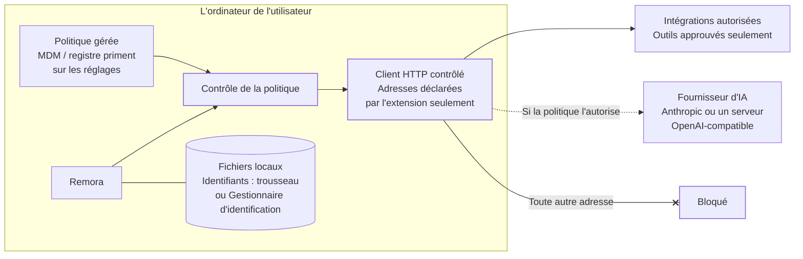

# DSI et conformité

Remora est une app de barre des menus sur macOS, et de zone de notification sur Windows (en aperçu), qui lit les
outils de travail de vos équipes (GitHub, GitLab, Azure DevOps, Slack, Linear, Jira, Notion, Microsoft 365) et montre ce qui a besoin d’elles. Elle est
pensée pour les organisations aux règles strictes sur les données : **aucune donnée ne quitte l’ordinateur, sauf vers
les outils que l’utilisateur, ou l’organisation, autorise.**

## En bref

| Question | Réponse |
|---|---|
| Y a-t-il un serveur ou un cloud Remora ? | Non. L’app parle directement aux outils ; rien ne passe par un tiers. |
| Comptes, télémétrie, analytics, rapports de plantage ? | Aucun. |
| Qu’envoie-t-elle aux outils ? | Le jeton de chaque utilisateur et des requêtes de lecture. Elle n’écrit jamais dans les outils. |
| Où sont les données ? | Sur l’ordinateur seulement : quelques fichiers JSON dans le dossier de l’utilisateur, les jetons dans le trousseau de session (macOS) ou le Gestionnaire d’identification (Windows). |
| Et l’IA ? | Sur l’appareil seulement par défaut (framework NaturalLanguage d’Apple sur macOS, règles de mots-clés sur Windows). L’assistant (Claude ou un serveur OpenAI-compatible) est facultatif, et peut être interdit. |
| La DSI peut-elle verrouiller ? | Oui : outils autorisés, IA externe, serveurs de l’assistant et avatars, par un profil de configuration (macOS) ou une stratégie de groupe et Intune (Windows). |
| Accessibilité ? | Vise le niveau AA des WCAG 2.1, partiellement conforme aujourd’hui : VoiceOver, le Narrateur et le clavier, avec les manques connus listés dans la [déclaration d’accessibilité](./accessibilite). |
| Code source ? | Public, GPL-3.0-or-later : [github.com/iGitScor/triage](https://github.com/iGitScor/triage). |

## Comment c’est appliqué

1. **Destinations déclarées.** Chaque extension déclare, dans son manifeste, les adresses qu’elle peut joindre et ce
   qu’elle envoie. Un test échoue sinon.
2. **Contrôle de la politique.** L’app construit les extensions à un seul endroit. Elle refuse celles que la politique
   n’autorise pas, et donne aux autres un client HTTP limité à leurs adresses (plus celle du compte pour les outils
   auto-hébergés). Toute autre adresse échoue avec « Bloqué : … n’est pas une destination autorisée », domaines
   imitateurs compris, et c’est testé aussi.
3. **IA externe désactivée par défaut.** Un assistant qui envoie du contenu hors de l’ordinateur est refusé tant que
   l’IA externe n’est pas autorisée ; un serveur sur cet ordinateur suit `AllowLocalAI`.
4. **Visible par l’utilisateur.** Réglages → Confidentialité liste les destinations de chaque compte connecté, et
   efface toutes les données locales en un clic.

## Ensuite

- [Synthèse sécurité](./securite) : les réponses à un questionnaire sécurité fournisseur, sur une page.
- [Flux de données](./flux-de-donnees) : chaque flux, ce qui est envoyé, et ce qui reste sur l’ordinateur.
- [Gérer la politique par MDM](./mdm) : les clés, un profil de configuration prêt à l’emploi, et les valeurs du registre Windows.
- [Déployer Remora](./deploiement) : le DMG et l’installeur Windows, la signature, les mises à jour.
