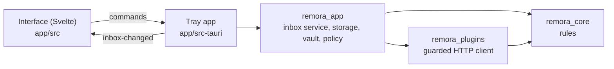

# Remora pour Windows et Linux

Statut : **aperçu**, pour les collègues sous Windows, et sous Linux (avec le soutien de la communauté). Une app de
zone de notification [Tauri 2](https://tauri.app) : un cœur en Rust et une interface Svelte sur WebView2 (WebKitGTK
sous Linux). Elle reprend les règles et les extensions de macOS avec les mêmes données de test et les mêmes tests,
pour que les apps se comportent pareil.

## Paquets

Chaque version publiée joint :

| Système | Fichier | Installation | Mises à jour |
|---|---|---|---|
| Windows | `Remora-Setup.exe` | Pour vous seul, sans droits d’administrateur | D’elle-même, si vous l’activez |
| Windows | `Remora.msi` | Pour tous les utilisateurs, par l’informatique (voir [Déploiement](/fr/admin/deploiement)) | L’informatique déploie chaque version |
| Linux | `Remora-x86_64.AppImage` | N’importe où, sans installation | D’elle-même, si vous l’activez |
| Linux | `Remora-amd64.deb` | Debian, Ubuntu et dérivées | Installer la suivante |

## Face au Mac

Pareil sur tous les systèmes : toutes les sources (GitHub, GitLab, Bitbucket, Azure DevOps, Slack, Linear, Jira,
Notion, Microsoft 365), l’assistant, les raisons de report et les constats, la préparation des relectures,
l’assistant d’attente, le classement personnel, les réactions Slack, le mode hors ligne, les mises à jour et la
politique de confidentialité. Ce qui change :

| | macOS | Windows | Linux |
|---|---|---|---|
| Trier les messages par leur sens | Mots-clés, puis un modèle de langue sur l’appareil | Mots-clés seulement : sans eux, un message va dans *À répondre* | Comme Windows |
| Liens entre outils | Clés de ticket, mots et embeddings sur l’appareil | Clés de ticket et mots : moins de liens | Comme Windows |
| Ouvrir Remora | Clic sur le poisson de la barre des menus | Clic sur l’icône de la zone de notification | *Ouvrir Remora* dans son menu ; une fenêtre au lancement là où le bureau n’a pas de zone de notification (GNOME d’origine) |
| Nouveau rappel | Tirer le poisson vers le bas | Ctrl+Alt+R (on ne peut pas tirer une icône de la zone de notification) | Ctrl+Alt+R ; sous Wayland par le portail du bureau (KDE Plasma, GNOME 48+), ou sinon un raccourci du système qui lance `remora --reminder` |
| Terminé, Reporter sur une ligne | Balayer, ou le clavier | Boutons sur chaque ligne, ou le clavier | Comme Windows |
| Boutons dans les notifications | ✓ | ✓ | Là où le bureau les affiche |
| Éléments dans la recherche du système (sur demande) | Spotlight | Pas encore | Pas encore |

## Où sont les choses

| | macOS | Windows | Linux |
|---|---|---|---|
| Jetons | Trousseau, un seul élément | Gestionnaire d’identification, une entrée par compte | Secret Service (GNOME Keyring, KWallet, KeePassXC) |
| Données | `~/Library/Application Support/Remora` | `%LOCALAPPDATA%\fr.igitscor.remora` | `~/.local/share/fr.igitscor.remora`, lisibles par vous seul |
| Politique gérée ([MDM](/fr/admin/mdm)) | Profil de configuration, domaine `fr.igitscor.remora` | `HKLM\SOFTWARE\Policies\Remora` (stratégie de groupe, Intune) | `/etc/remora/policy.json` |
| Certificats | Confiance du système | Le magasin de certificats de Windows : les certificats racine d’entreprise fonctionnent | Les certificats du système |

## Parties et tests

| Partie | Contenu | Tests |
|---|---|---|
| `crates/remora_core` | Domaine et règles : verbes, À moi / En attente, priorisation, règles de Terminé et de report, détection des changements, horloge et conseiller de report (raisons, retours, constats), préparation des relectures, assistant d’attente, classement personnel, liens entre outils, données et politique de l’assistant, politique de conformité | 163 |
| `crates/remora_plugins` | GitHub, GitLab, Bitbucket, Azure DevOps, Slack, Linear, Jira, Notion et Microsoft 365 ; l’assistant : Claude par l’API ou par Claude Code, ou un serveur OpenAI-compatible ; le client HTTP limité aux adresses déclarées par chaque extension | 190 |
| `crates/remora_app` | Stockage, le coffre du Gestionnaire d’identification, la politique du registre, le service de boîte de réception que pilote l’app (historique, apprentissage, brief, résumés et tri de l’assistant), et ce qu’affiche la zone de notification | 122 |
| `app/src-tauri` | Dessine l’icône et la fenêtre surgissante, les notifications, le lancement avec Windows, le raccourci de rappel, les avatars, les mises à jour, les commandes : se contente d’appeler `remora_app` | 6 |
| `app/src` | L’interface Svelte, en anglais et en français | types vérifiés, 102 |

## Comment tout s’assemble



L’app actualise toutes les quelques minutes, et vérifie toutes les 30 secondes les reports et rappels arrivés à
échéance (Windows ne sait pas programmer des notifications à l’avance comme macOS). Les appels réseau se font sans
garder le verrou de la boîte de réception, donc l’interface n’attend jamais un outil lent. Les jetons sont enregistrés
de la même façon : chaque changement (connexion, reconnexion, déconnexion, effacement, connexion renouvelée) passe par
`Tokens` dans `remora_app`, un à la fois, le coffre écrit sans le verrou.

`Inbox` (`remora_app/src/inbox/`) est une façade sur les mêmes services que l’`InboxModel` du Mac : `AccountsService`
(comptes, jetons, sessions), `SyncEngine` (tâches et résultats des actualisations, ralentissements, notifications
retenues), `SnoozeService` (historique, conseiller), `AssistantCoordinator` (résumé, synthèses, tri),
`LearningService` (classement, durées des revues) et `Persistence` (les fichiers), avec `InboxPolicy` pour la
politique de confidentialité. Ses champs sont privés : un changement passe par une méthode qui l’enregistre et applique la politique
(`set_preferences`, `set_managed`).

## Construire et tester

Demande Rust ([rustup](https://rustup.rs/), qui installe la version de `desktop/rust-toolchain.toml`) et Node 22.

```sh
cd desktop
cargo test                         # the library crates, on any OS
cd app && npm ci
npm run tauri dev -- -- --demo     # sample data in a window
npm run check && npm run build     # type-check and build the interface
node scripts/preview.mjs           # every screen, English and French, light and dark
npm run tauri build                # the installer (on Windows)
```

La CI lance la vérification de types, clippy avec les avertissements traités comme des erreurs, tous les tests et
la construction de l’installeur sur `windows-latest`.

Les types de l’interface (`app/src/lib/bindings.ts`) sont générés depuis les structures Rust avec
[ts-rs](https://github.com/Aleph-Alpha/ts-rs) : après avoir changé ce qu’envoie une commande, lancez
`make desktop-bindings`. Un test échoue tant que le fichier n’est pas à jour, et la vérification de types confronte aussi
la fixture de l’aperçu (`make desktop-fixture`) à ces types.
